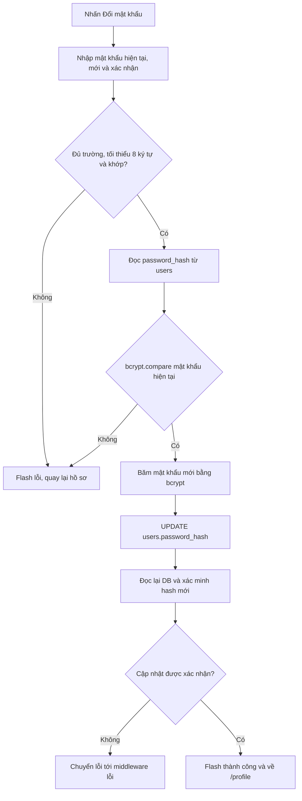
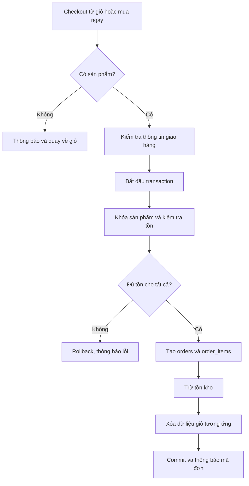
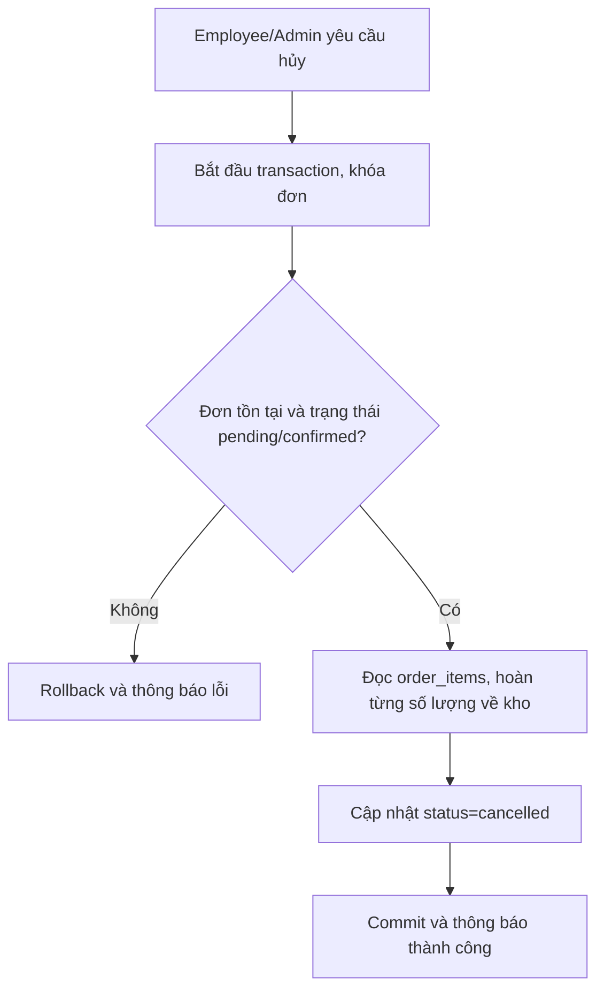

# Đặc tả hệ thống ElectroShop

> **Phạm vi tài liệu:** mô tả hành vi của mã nguồn ElectroShop hiện tại (Node.js, Express, EJS, MySQL/MariaDB). Chức năng có trong tài liệu là hành vi thiết kế/triển khai trong repository; cần hoàn thành kiểm thử trên môi trường đích trước khi xem là nghiệm thu production.

## 1. Mục tiêu và phạm vi

ElectroShop hỗ trợ khách duyệt và mua sản phẩm điện tử, theo dõi đơn hàng; nhân viên vận hành sản phẩm/đơn hàng; quản trị viên quản lý toàn bộ khu vực quản trị.

### 1.1. Trong phạm vi

- Tài khoản, đăng ký, đăng nhập, đăng xuất, cập nhật hồ sơ và đổi mật khẩu.
- Danh mục và sản phẩm; tìm kiếm, lọc, chi tiết, upload ảnh.
- Giỏ hàng, mua ngay, checkout, tạo và theo dõi đơn, hủy đơn/hoàn kho.
- Đánh giá sản phẩm, danh sách yêu thích, trợ lý gợi ý.
- Phân quyền `user`, `employee`, `admin`.

### 1.2. Ngoài phạm vi hiện tại

- Thanh toán trực tuyến, hoàn tiền qua cổng thanh toán.
- Gửi email/SMS tự động.
- Quản lý vận chuyển bên thứ ba, kế toán, báo cáo doanh thu nâng cao.
- Thu hồi đồng loạt những session đang tồn tại sau khi mật khẩu bị đổi.

## 2. Tác nhân và phân quyền

| Tác nhân | Quyền chính |
|---|---|
| Khách (`Guest`) | Xem trang chủ, danh sách/chi tiết sản phẩm, tìm kiếm/lọc, dùng trợ lý gợi ý, đăng ký, đăng nhập, xem hỗ trợ; có thể bắt đầu luồng mua ngay trước khi đăng nhập. |
| Khách hàng (`user`) | Quyền Guest; quản lý hồ sơ và mật khẩu, giỏ hàng, checkout, xem danh sách/chi tiết đơn của mình, hủy đơn `pending`, đánh giá sản phẩm đủ điều kiện, quản lý wishlist. |
| Nhân viên (`employee`) | Đăng nhập; vào `/admin`, xem thống kê chung, quản lý sản phẩm và đơn hàng. Không được quản lý nhân viên hoặc danh mục. |
| Quản trị viên (`admin`) | Toàn bộ quyền nhân viên; thêm/sửa/xóa nhân viên và quản lý danh mục. |

Middleware `requireLogin`, `requireStaff` và `requireAdmin` kiểm tra session/role. Ẩn menu chỉ là hỗ trợ giao diện; quyền truy cập phải được kiểm tra ở route.

## 3. Quy tắc nghiệp vụ

1. Email tài khoản là duy nhất; số điện thoại có unique index nếu migration tương ứng đã áp dụng.
2. Mật khẩu được lưu dưới dạng bcrypt hash trong `users.password_hash`, không lưu plaintext.
3. Mật khẩu đăng ký, đổi tại trang hồ sơ và mật khẩu nhân viên tạo mới tối thiểu 8 ký tự.
4. Giá trong `order_items.unit_price` là giá tại thời điểm đặt hàng; thay đổi giá sản phẩm không làm đổi giá trị đơn cũ.
5. Khi checkout, hệ thống kiểm tra tồn kho trong transaction, tạo đơn/chi tiết và trừ kho nguyên tử.
6. Khách chỉ xem đơn có `orders.user_id` bằng ID trong session và chỉ tự hủy đơn `pending`.
7. Hủy đơn từ giao diện quản trị chỉ áp dụng với đơn `pending` hoặc `confirmed`. Hủy đơn hoàn lại từng số lượng từ `order_items` và đổi trạng thái trong transaction.
8. Luồng trạng thái quản trị: `pending → confirmed` hoặc `cancelled`; `confirmed → shipping` hoặc `cancelled`; `shipping → completed`; `completed` và `cancelled` là trạng thái cuối. Route từ chối chuyển trạng thái ngoài luồng này.
9. Chỉ khách đã có đơn `completed` chứa sản phẩm mới được đánh giá. Mỗi khách có tối đa một bản ghi đánh giá cho mỗi sản phẩm; đánh giá mới cập nhật bản cũ.
10. Wishlist và giỏ hàng thường được liên kết với tài khoản; mỗi sản phẩm xuất hiện tối đa một lần trong wishlist/giỏ hàng của cùng người dùng.
11. Sản phẩm đã được tham chiếu từ `order_items` không thể xóa vật lý; sản phẩm có thể được ngừng hiển thị bằng `is_active`.

## 4. Danh sách chức năng và route chính

| Nhóm | Route tiêu biểu | Quyền |
|---|---|---|
| Trang chủ | `GET /` | Công khai |
| Tài khoản | `GET/POST /auth/register`, `GET/POST /auth/login`, `POST /auth/logout` | Công khai |
| Cửa hàng | `GET /products`, `GET /products/:id` | Công khai |
| Đánh giá | `POST /products/:id/reviews` | Đã đăng nhập và phải thỏa điều kiện đơn hoàn tất |
| Giỏ hàng/mua ngay | `GET /cart`, `POST /cart/add`, `POST /cart/update/:id`, `POST /cart/remove/:id` | Đăng nhập cho giỏ; mua ngay có thể bắt đầu khi chưa đăng nhập |
| Checkout/đơn khách hàng | `GET /orders/checkout`, `POST /orders`, `GET /orders`, `GET /orders/:id`, `POST /orders/:id/cancel` | Khách hàng |
| Hồ sơ/mật khẩu | `GET/POST /profile`, `POST /profile/password` | Đăng nhập |
| Wishlist | `GET /wishlist`, `POST /wishlist/:productId/add`, `POST /wishlist/:productId/remove` | Đăng nhập |
| Trợ lý | `POST /assistant` | Công khai; trả JSON |
| Quản trị | `/admin/products`, `/admin/orders` | Employee và admin |
| Quản lý nhân viên/danh mục | `/admin/users`, `/admin/categories` | Chỉ admin |

Các route tương thích ngược trong `routes/adminRoutes.js` chuyển tiếp tới màn hình quản trị tương ứng.

## 5. Mô hình dữ liệu

### 5.1. Bảng chính

| Bảng | Vai trò và dữ liệu quan trọng |
|---|---|
| `users` | Tài khoản; `full_name`, `email`, `password_hash`, thông tin liên hệ, `role` (`user`, `employee`, `admin`), `position`. |
| `categories` | Danh mục; `name`, `slug` duy nhất, `description`. |
| `products` | Sản phẩm; `category_id`, `name`, `brand`, `description`, `price`, `stock_qty`, `image_url`, `is_active`. |
| `cart_items` | Sản phẩm/số lượng trong giỏ theo `user_id`; cặp `(user_id, product_id)` duy nhất. |
| `orders` | Chủ đơn, người nhận, tổng tiền, trạng thái, địa chỉ, số điện thoại, ghi chú, thời gian tạo. |
| `order_items` | Sản phẩm, số lượng, `unit_price` tại thời điểm đặt hàng, liên kết tới đơn. |
| `reviews` | Người đánh giá, sản phẩm, điểm 1–5, bình luận; cặp user/sản phẩm duy nhất. |
| `wishlist_items` | Sản phẩm yêu thích theo tài khoản; cặp user/sản phẩm duy nhất. |

### 5.2. Liên kết và toàn vẹn

- `products.category_id` tham chiếu `categories.id`; không xóa danh mục còn sản phẩm phụ thuộc.
- `orders.user_id` tham chiếu tài khoản; `order_items.order_id` tham chiếu đơn.
- `order_items.product_id` không cascade delete để bảo toàn chi tiết lịch sử mua.
- Các bảng tài khoản, giỏ hàng, wishlist và đánh giá dùng khóa ngoại theo định nghĩa trong `database/schema.sql`.
- Schema cài mới và migration cho database hiện hữu là hai cách khởi tạo khác nhau; cần kiểm tra migration đã áp dụng trước khi chạy lại.

## 6. Đặc tả use case

### UC-01 — Duyệt cửa hàng và tìm sản phẩm

- **Tác nhân:** Guest, Customer.
- **Tiền điều kiện:** Không.
- **Luồng chính:** Người dùng mở `/` hoặc `/products`; hệ thống hiển thị danh mục/sản phẩm đang hoạt động. Trang sản phẩm hỗ trợ từ khóa tên/thương hiệu, bộ lọc danh mục/thương hiệu và phân trang 12 sản phẩm/trang. Mở `/products/:id` để xem thông tin sản phẩm, đánh giá, điểm trung bình và lựa chọn giỏ hàng/mua ngay.
- **Ngoại lệ:** Sản phẩm không tồn tại hoặc không còn hoạt động thì trả trang 404; không có kết quả tìm kiếm thì hiển thị danh sách rỗng.
- **Hậu điều kiện:** Không thay đổi dữ liệu.

### UC-02 — Đăng ký tài khoản

- **Tác nhân:** Guest.
- **Tiền điều kiện:** Chưa đăng nhập.
- **Luồng chính:** Nhập họ tên, email, số điện thoại, mật khẩu, xác nhận và địa chỉ tùy chọn; hệ thống kiểm tra định dạng, độ dài, mật khẩu tối thiểu 8 ký tự, mật khẩu khớp và thông tin duy nhất; bcrypt hash mật khẩu, tạo tài khoản `role=user`, thông báo thành công và chuyển tới đăng nhập.
- **Ngoại lệ:** Thiếu/sai dữ liệu, email/số điện thoại trùng hoặc mật khẩu không khớp thì không tạo tài khoản và trả flash lỗi.
- **Hậu điều kiện:** Có bản ghi người dùng mới; DB chỉ lưu hash.

### UC-03 — Đăng nhập và đăng xuất

- **Tác nhân:** Tài khoản thuộc một trong ba role.
- **Tiền điều kiện đăng nhập:** Có tài khoản.
- **Luồng chính:** Nhập email/mật khẩu; hệ thống truy vấn user và dùng `bcrypt.compare` với `password_hash`. Nếu khớp, lưu `id`, `full_name`, `email`, `role` vào session. Lựa chọn “ghi nhớ đăng nhập” đặt thời hạn cookie dài hơn. Admin được chuyển tới `/admin`; employee và user được chuyển tới trang chủ, từ đó employee có thể vào khu vực quản trị.
- **Ngoại lệ:** Email không tồn tại hoặc mật khẩu sai thì trả cùng thông báo chung; route xác thực chịu rate limit.
- **Đăng xuất:** `POST /auth/logout` hủy session và chuyển về trang chủ. Giỏ hàng trong database không bị xóa.

### UC-04 — Cập nhật hồ sơ

- **Tác nhân:** Tài khoản đã đăng nhập.
- **Luồng chính:** Mở `/profile`, cập nhật họ tên, email, số điện thoại, giới tính, ngày sinh hoặc địa chỉ; hệ thống kiểm tra dữ liệu và tính duy nhất của email/số điện thoại, cập nhật bản ghi `users` và đồng bộ tên/email vào session.
- **Ngoại lệ:** Dữ liệu không hợp lệ hoặc trùng tài khoản khác thì dữ liệu không được cập nhật và có flash lỗi.
- **Ghi chú:** Form hồ sơ không chứa trường mật khẩu hiện tại; đổi mật khẩu là use case riêng.

### UC-05 — Đổi mật khẩu

- **Tác nhân:** Tài khoản đã đăng nhập.
- **Tiền điều kiện:** Đã mở form “Đổi mật khẩu” tại `/profile`.
- **Luồng chính:**
  1. Nhập mật khẩu hiện tại, mật khẩu mới và xác nhận mật khẩu mới.
  2. Client và server yêu cầu đủ trường; server yêu cầu mật khẩu mới tối thiểu 8 ký tự và hai trường mật khẩu mới trùng nhau.
  3. Hệ thống lấy `password_hash` hiện tại theo ID tài khoản và xác minh mật khẩu hiện tại bằng bcrypt.
  4. Hệ thống bcrypt hash mật khẩu mới và cập nhật `users.password_hash`.
  5. Hệ thống đọc lại hash từ database và xác minh hash mới bằng mật khẩu vừa nhập.
  6. Khi cập nhật/đối chiếu thành công, hiển thị flash thành công và chuyển về `/profile`.
- **Ngoại lệ:** Thiếu trường, mật khẩu mới ngắn/không khớp, mật khẩu hiện tại sai hoặc không tìm thấy tài khoản thì không báo đổi thành công. Lỗi DB được chuyển tới middleware xử lý lỗi.
- **Hậu điều kiện:** Lần đăng nhập mới dùng mật khẩu mới; mật khẩu cũ không khớp hash trong DB. Session hiện tại vẫn tiếp tục hoạt động; hệ thống chưa có cơ chế thu hồi mọi session khác.

### UC-06 — Quản lý giỏ hàng

- **Tác nhân:** Customer.
- **Tiền điều kiện:** Đăng nhập.
- **Luồng chính:** Thêm sản phẩm, cập nhật số lượng hoặc xóa dòng trong giỏ; server kiểm tra sản phẩm và tồn kho; giỏ thường được lưu trong `cart_items` theo tài khoản. Tổng tiền tính từ giá hiện tại và số lượng.
- **Ngoại lệ:** Sản phẩm hết hàng/không còn khả dụng hoặc số lượng không hợp lệ thì từ chối cập nhật và thông báo phù hợp.
- **Hậu điều kiện:** `cart_items` của tài khoản được cập nhật.

### UC-07 — Mua ngay

- **Tác nhân:** Guest, Customer.
- **Luồng chính:** Chọn số lượng và nhấn mua ngay; mặt hàng được lưu trong `session.buyNow`, tách biệt giỏ thường. Customer được chuyển thẳng tới checkout; Guest được yêu cầu đăng nhập rồi quay lại checkout.
- **Ngoại lệ:** Sản phẩm không tồn tại/hết hàng hoặc số lượng không hợp lệ thì không tạo luồng mua ngay.
- **Hậu điều kiện:** Có dữ liệu mua ngay tạm trong session cho lần checkout.

### UC-08 — Checkout và tạo đơn

- **Tác nhân:** Customer.
- **Tiền điều kiện:** Đăng nhập; giỏ thường hoặc `buyNow` có ít nhất một sản phẩm.
- **Luồng chính:**
  1. Mở `/orders/checkout`; hệ thống nạp mua ngay nếu có, nếu không thì lấy giỏ theo tài khoản.
  2. Nhập người nhận, địa chỉ giao hàng, số điện thoại và ghi chú tùy chọn.
  3. Server kiểm tra dữ liệu; bắt đầu transaction.
  4. Khóa từng dòng sản phẩm bằng `FOR UPDATE`; kiểm tra sản phẩm hoạt động và đủ tồn.
  5. Tạo `orders`, ghi từng `order_items` với giá hiện tại, trừ tồn kho.
  6. Xóa giỏ đã đặt hoặc dữ liệu mua ngay, commit và thông báo mã đơn.
- **Ngoại lệ:** Giỏ trống, thông tin không hợp lệ hoặc thiếu tồn kho thì rollback/không tạo đơn và trả thông báo phù hợp.
- **Hậu điều kiện:** Có đơn và chi tiết đơn; tồn kho giảm tương ứng; dữ liệu giỏ liên quan được dọn sau thành công.
- **Thanh toán:** Chức năng hiện tại ghi nhận đơn hàng nội bộ, chưa thu tiền qua cổng trực tuyến.

### UC-09 — Xem danh sách và chi tiết đơn

- **Tác nhân:** Customer.
- **Tiền điều kiện:** Đăng nhập.
- **Luồng chính:** `GET /orders` lấy đơn theo `user_id`, hỗ trợ lọc trạng thái và phân trang 10 đơn/trang. `GET /orders/:id` truy vấn với cả ID đơn và ID người dùng session, hiển thị mã đơn, trạng thái, người nhận, địa chỉ, điện thoại, ghi chú, sản phẩm, số lượng, đơn giá, thành tiền và tổng tiền.
- **Ngoại lệ:** Đơn không tồn tại hoặc không thuộc tài khoản hiện tại trả 404.
- **Hậu điều kiện:** Không thay đổi dữ liệu.

### UC-10 — Khách hủy đơn

- **Tác nhân:** Customer là chủ đơn.
- **Tiền điều kiện:** Đơn có trạng thái `pending`.
- **Luồng chính:** Hệ thống bắt đầu transaction, khóa đơn thỏa `id`, `user_id` và `status=pending`; hoàn kho từng sản phẩm từ `order_items`; cập nhật trạng thái `cancelled`; commit.
- **Ngoại lệ:** Đơn không tồn tại, không thuộc khách hoặc không còn pending thì không thay đổi đơn/kho và hiển thị thông báo chung.
- **Hậu điều kiện:** Đơn bị hủy và kho được hoàn nếu thao tác hợp lệ.

### UC-11 — Đánh giá sản phẩm

- **Tác nhân:** Customer.
- **Tiền điều kiện:** Đăng nhập và có đơn `completed` chứa sản phẩm.
- **Luồng chính:** Gửi điểm 1–5 và bình luận tối đa 2.000 ký tự; hệ thống kiểm tra quyền mua và lưu đánh giá. Đánh giá mới cho cùng sản phẩm cập nhật bản ghi hiện tại.
- **Ngoại lệ:** Điểm/bình luận sai hoặc chưa mua và nhận hàng thành công thì từ chối.
- **Hậu điều kiện:** Bảng `reviews` được thêm/cập nhật.

### UC-12 — Wishlist

- **Tác nhân:** Customer.
- **Tiền điều kiện:** Đăng nhập.
- **Luồng chính:** Thêm sản phẩm đang hoạt động vào `wishlist_items`, xem danh sách hoặc xóa một sản phẩm. Thêm lặp không tạo dòng trùng.
- **Hậu điều kiện:** Danh sách yêu thích của tài khoản được cập nhật.

### UC-13 — Trợ lý gợi ý sản phẩm

- **Tác nhân:** Guest, Customer.
- **Luồng chính:** Gửi yêu cầu tối đa 200 ký tự tới `POST /assistant`; hệ thống chuẩn hóa tiếng Việt, nhận diện một số danh mục/từ khóa/ngân sách, lọc hàng đang hoạt động và còn tồn, trả tối đa ba kết quả dưới dạng JSON.
- **Ngoại lệ:** Nội dung rỗng hoặc không có sản phẩm phù hợp thì trả phản hồi tương ứng.
- **Giới hạn:** Đây là logic tìm kiếm/gợi ý theo catalog, không phải mô hình AI hội thoại.

### UC-14 — Quản lý sản phẩm

- **Tác nhân:** Employee, Admin.
- **Luồng chính:** Xem danh sách phân trang; thêm/sửa sản phẩm với danh mục, tên, thương hiệu, mô tả, giá, tồn kho và ảnh. Ảnh tải lên giới hạn 5 MB, chỉ nhận JPG/JPEG/PNG/WebP theo kiểm tra định dạng, được xoay/resize tối đa trong khung 1600×1600 và chuyển sang WebP.
- **Ngoại lệ:** Dữ liệu không hợp lệ hoặc upload không được chấp nhận thì không lưu thay đổi tương ứng; sản phẩm đã tham chiếu đơn hàng không bị xóa vật lý.
- **Quyền:** Employee/admin; quản lý danh mục là quyền admin.

### UC-15 — Quản lý đơn hàng nhân viên/quản trị viên

- **Tác nhân:** Employee, Admin.
- **Luồng chính:** Xem danh sách phân trang và chi tiết; cập nhật trạng thái trong transaction với khóa dòng đơn. Nếu chuyển đơn hợp lệ sang cancelled, hoàn kho trước khi commit. Route tương thích `/admin/bills/cancel/:id` chỉ hủy `pending`/`confirmed`.
- **Ngoại lệ:** Trạng thái không nằm trong danh sách hoặc chuyển tiếp không hợp lệ thì rollback và flash lỗi.
- **Quyền:** Employee/admin.

### UC-16 — Quản lý danh mục và nhân viên

- **Tác nhân:** Admin.
- **Luồng chính:** Tạo/sửa/xóa danh mục; tạo/sửa/xóa tài khoản employee. Mật khẩu nhân viên được bcrypt hash; `position` là mô tả chức vụ, còn `role` quyết định quyền.
- **Ngoại lệ:** Dữ liệu không hợp lệ, email/số điện thoại trùng hoặc danh mục còn sản phẩm phụ thuộc thì từ chối thay đổi.
- **Quyền:** Chỉ admin; các route tương ứng có middleware server-side.

### UC-17 — Xem thống kê quản trị

- **Tác nhân:** Employee, Admin.
- **Luồng chính:** Khi truy cập `/admin`, hệ thống đếm sản phẩm đang hoạt động, đơn hàng và người dùng rồi hiển thị trang tổng quan.
- **Giới hạn:** Đây là số liệu đếm tổng quan, không phải báo cáo doanh thu/biểu đồ.

## 7. Yêu cầu phi chức năng

### 7.1. Bảo mật

- Mật khẩu băm bằng bcrypt; không đưa password/hash vào session.
- Form được bảo vệ bằng CSRF; Helmet thiết lập các HTTP security headers.
- Nhóm route xác thực bị giới hạn tần suất 20 request trong 15 phút theo cấu hình hiện tại.
- Dùng truy vấn tham số hóa cho dữ liệu người dùng trong các truy vấn SQL nghiệp vụ.
- Nội dung EJS phải được render theo cơ chế escape mặc định; không đưa input tùy ý vào raw HTML.
- Session cookie có `httpOnly`, `sameSite=lax`, `secure` khi `NODE_ENV=production`; secret lấy từ biến môi trường.
- Request body bị giới hạn 100 KB; upload ảnh có giới hạn riêng 5 MB.

### 7.2. Toàn vẹn và xử lý đồng thời

- Các thao tác đặt/hủy đơn và chuyển trạng thái ảnh hưởng tồn kho sử dụng transaction.
- Khóa dòng đơn/sản phẩm bằng `FOR UPDATE` tại các bước cần tránh cập nhật đồng thời.
- Khóa ngoại và unique key được định nghĩa trong schema/migration.

### 7.3. Khả dụng và giao diện

- Giao diện render bằng EJS, CSS responsive; thông báo thao tác dùng flash message.
- Danh sách sản phẩm và đơn hàng có phân trang.
- Lỗi request được chuyển tới middleware lỗi chung; route không được quyền trả hướng điều hướng/thông báo theo quy ước hiện có.

### 7.4. Hạn chế kỹ thuật đang biết

- Session được lưu trong MySQL thông qua `express-mysql-session`; bảng `sessions` được tạo tự động khi ứng dụng khởi động.
- Ảnh sản phẩm lưu trong thư mục `UPLOAD_DIR`; Railway cần gắn persistent volume tại `/app/data` và đặt `UPLOAD_DIR=/app/data/images/products`.
- Đổi mật khẩu cập nhật credential DB nhưng không thu hồi session đang hoạt động ở thiết bị/phiên khác.
- Chưa có cổng thanh toán trực tuyến, gửi email giao dịch hoặc báo cáo doanh thu chuyên sâu.

## 8. Luồng nghiệp vụ chính

### 8.1. Đổi mật khẩu

### 8.2. Đặt hàng

### 8.3. Nhân viên hủy đơn

## 9. Điều kiện nghiệm thu

- Guest không thể dùng chức năng yêu cầu đăng nhập; user không thể truy cập khu vực admin.
- Employee thao tác được sản phẩm/đơn hàng nhưng bị từ chối ở route quản lý danh mục/nhân viên.
- User chỉ xem được chi tiết đơn của chính mình.
- Đổi mật khẩu thành công được ghi vào `users.password_hash`; đăng nhập mới bằng mật khẩu mới thành công, mật khẩu cũ bị từ chối.
- Hủy đơn hợp lệ hoàn kho đúng một lần và cập nhật trạng thái nguyên tử; đơn đã hủy/hoàn tất không thể hủy lần nữa.
- Schema và các migration cần thiết được áp dụng đúng trên database kiểm thử.
- Các luồng nêu trên được kiểm thử thủ công hoặc tự động trên môi trường có database, trước khi nghiệm thu production.
